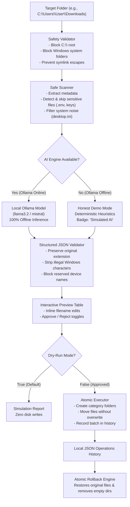

# 🦥 SlothSort AI

> **Hacktoberfest 2026: Slow and Steady Challenge**  
> *Privacy-First, Offline AI File Organizer Powered by Local Open-Weight Models*

[](LICENSE)
[](backend/)
[](backend/)
[](frontend/)
[](frontend/)
[](https://ollama.com)
[](#privacy-guarantees)

---

## 📖 Table of Contents

- [Overview & The "Slow and Steady" Philosophy](#overview--the-slow-and-steady-philosophy)
- [The Problem Being Solved](#the-problem-being-solved)
- [Why Local Open-Weight AI is Essential](#why-local-open-weight-ai-is-essential)
- [Key Features](#key-features)
- [Safety & Privacy Architecture](#safety--privacy-architecture)
- [Application Architecture](#application-architecture)
- [Honest Demo Mode (Simulated AI)](#honest-demo-mode-simulated-ai)
- [Installation & Setup on Windows](#installation--setup-on-windows)
- [Configuring Local Ollama Models](#configuring-local-ollama-models)
- [Running the Application](#running-the-application)
- [Testing & Quality Assurance](#testing--quality-assurance)
- [Cost Trade-offs: Local AI vs Cloud APIs](#cost-trade-offs-local-ai-vs-cloud-apis)
- [Model Licensing Considerations](#model-licensing-considerations)
- [Security Limitations](#security-limitations)
- [Future Roadmap](#future-roadmap)
- [License](#license)

---

## 🦥 Overview & The "Slow and Steady" Philosophy

Automated file organizers often fail because they move too fast: scripts run blindly in the background, opaque rules scatter your tax returns across unknown directories, and cloud services demand you upload your private personal documents to external servers.

**SlothSort AI** takes the opposite approach:
- **Slow**: Every action is inspectable. Nothing moves without explicit, line-by-line user approval.
- **Steady**: Defaults to **Dry-Run mode**, checks for name collisions, and preserves an atomic, single-click **Undo** log for every operation batch.
- **Local**: Runs completely offline using local open-weight language models via [Ollama](https://ollama.com). Not a single byte of your file metadata or content ever leaves your machine.

---

## 🎯 The Problem Being Solved

User `Downloads`, `Desktop`, and project directories quickly become dumping grounds containing hundreds of poorly named files:
- `IMG_9482.jpg`, `IMG_9483.jpg` (Cryptic camera imports)
- `hw3_cs101_draft_final_v2.docx` (Student homework drafts)
- `invoice_unpaid_2026.pdf` (Bills and financial statements)
- `Screenshot 2026-10-18 at 14.30.png` (Unlabeled screenshots)
- `.env.local` or `id_rsa_backup.key` (Sensitive credentials accidentally stored in downloads)

Manual organization is tedious. Existing cloud-based AI tools demand that users upload personal file lists or full documents to third-party APIs (OpenAI, Anthropic, Google), creating major privacy and data leakage risks.

**SlothSort AI solves this** by executing semantic categorization and descriptive renaming entirely on your local CPU or GPU, with zero telemetry and safe rollback support.

---

## 🛡️ Why Local Open-Weight AI is Essential

1. **Absolute Data Privacy**: Your filesystem structure reflects your personal and professional life. Sending filenames or document snippets over the public internet exposes employment details, financial records, student IDs, and project codenames.
2. **Air-Gapped & Offline Autonomy**: Works on trains, airplanes, remote environments, and strictly air-gapped corporate workstations without requiring internet access.
3. **No Subscription Lock-in**: Open-weight models (Llama 3.2, Mistral, Phi-3, Qwen 2.5) are completely free to run on your own hardware without token fees, rate limits, or API outages.
4. **Transparent Governance**: You inspect the prompt, you choose the model weights, and you control the exact execution parameters.

---

## ✨ Key Features

| Feature | Description |
| :--- | :--- |
| **Safe Folder Selection** | Windows-compatible folder workflow with automatic blocking of root drives (`C:\`) and Windows system folders. |
| **1-Click Demo Mess Generator** | Built-in button to instantly create a safe test folder with mock docs, images, spreadsheets, and sensitive test files. |
| **Sensitive File Shield** | Automatically detects and excludes sensitive credentials (`.env`, `id_rsa`, `*.pem`, `*.key`) from processing or renaming. |
| **Ollama Local AI Inference** | Formats safe, untrusted metadata into structured JSON prompts for local models (e.g. `llama3.2`). |
| **Honest Demo Mode** | If Ollama is offline or uninstalled, seamlessly falls back to a deterministic semantic heuristic engine with clear labeling. |
| **Interactive Plan Preview** | Displays original name, proposed category, inline editable filename, destination path, and collision status. |
| **Dry-Run Simulation** | Enabled by default; simulates all folder creation and collision resolutions without touching the disk. |
| **Non-Destructive Collisions** | Automatically numbers conflicting files (`Photo_1.jpg`, `Photo_2.jpg`) or skips them—**never overwrites existing files**. |
| **Atomic Undo & History Log** | Stores batch operations in a local JSON log; reverts file moves and cleans up empty created folders with 1-click. |
| **Sage & Cream Aesthetic** | Modern, accessible dashboard with micro-animations, glassmorphism cards, and Google Fonts typography. |

---

## 🔒 Safety & Privacy Architecture



---

## 🚀 Installation & Setup on Windows

### Prerequisites

- **Windows 10 / 11**
- **Python 3.10+** (Available via `py` or `python`)
- **Node.js v18+** & **npm**
- *(Optional for real AI)* **[Ollama for Windows](https://ollama.com/download/windows)**

---

### Step 1: Clone the Repository

```powershell
git clone https://github.com/your-username/SlothSort-AI.git
cd "SlothSort AI"
```

---

### Step 2: Install Backend Dependencies

From the project root:

```powershell
py -m pip install -r backend/requirements.txt
```

---

### Step 3: Install Frontend Dependencies

```powershell
cd frontend
npm install
cd ..
```

---

### Step 4 (Optional): Install and Run Ollama for Local AI

1. Download and install Ollama from [ollama.com/download/windows](https://ollama.com/download/windows).
2. Open PowerShell and pull your preferred lightweight model (e.g. Llama 3.2 3B or 1B):

```powershell
ollama pull llama3.2
```

3. Ensure the Ollama service is running on its default port (`http://localhost:11434`).

> **Note:** If Ollama is not installed or running, SlothSort AI will automatically run in **Honest Demo Mode** using its built-in rule heuristics.

---

## 💻 Running the Application

### Option A: One-Click Windows Batch Launcher

Double-click `run_slothsort.bat` or run:

```powershell
.\run_slothsort.bat
```

This launches both the FastAPI backend and Vite frontend, then opens your default browser at `http://localhost:5173/`.

---

### Option B: Manual Startup

**Terminal 1 (Backend):**
```powershell
py -m uvicorn backend.app.main:app --host 127.0.0.1 --port 8000 --reload
```

**Terminal 2 (Frontend):**
```powershell
cd frontend
npm run dev
```

Visit **http://localhost:5173** in your browser.

---

## 🧪 Testing & Quality Assurance

SlothSort AI includes a comprehensive automated test suite covering safety constraints, duplicate collision resolution, organization planning, atomic undo logic, and API integration.

### Running Backend Unit Tests

```powershell
py -m pytest backend/tests -v
```

**Test Suite Coverage (21/21 Passing):**
- `test_safety.py`:
  - Empty and non-existent path validation
  - Drive root rejection (`C:\`, `/`)
  - Windows system directory protection (`C:\Windows`, `System32`, `Program Files`)
  - Boundary traversal and symlink escape prevention
  - Illegal Windows filename characters (`< > : " / \ | ? *`)
  - Reserved device name handling (`CON`, `PRN`, `AUX`, `NUL`, `COM1`)
  - Sensitive credential detection (`.env`, `id_rsa`, `.key`, `.pem`)
- `test_duplicates.py`:
  - Collision resolution with automatic counter increment (`file_1.ext`, `file_2.ext`)
  - Non-colliding path preservation
- `test_organizer.py`:
  - Deterministic heuristic classification across categories
  - Academic cue mapping (`College` category for homework/assignments)
  - Demo mode plan generation and schema integrity
  - Ollama prompt structure and extension preservation rules
- `test_undo.py`:
  - Dry-run verification (ensures zero disk modifications)
  - Real move execution and atomic rollback
  - Automatic cleanup of emptied category folders
- `test_api.py`:
  - Full end-to-end FastAPI endpoint integration via `TestClient`

### Running Frontend Production Build Test

```powershell
cd frontend
npm run build
```

---

## ⚖️ Cost Trade-offs: Local AI vs Cloud APIs

| Factor | Local Open-Weight (SlothSort AI) | Cloud AI APIs (OpenAI / Claude) |
| :--- | :--- | :--- |
| **Privacy** | **100% Private** — Zero external transmission | Metadata & file contents sent to 3rd-party servers |
| **Recurring Cost** | **$0.00 / month** — Forever free | Pay-per-token API bills ($0.001 - $0.03 / request) |
| **Internet Dependency** | **None** — Works fully air-gapped | Mandatory high-speed internet connection |
| **Rate Limits** | **None** — Constrained only by local compute | Strict requests/minute & tokens/minute quotas |
| **Hardware Requirement** | 4GB - 8GB RAM (CPU or entry-level GPU) | Minimal local hardware (runs in browser) |
| **Setup Effort** | 1-click Ollama install | Requires account registration, credit card, and API keys |

---

## 📜 Model Licensing Considerations

SlothSort AI itself is distributed under the permissive **MIT License**.

When pairing SlothSort AI with local open-weight language models via Ollama:
- **Llama 3.2 (Meta)**: Distributed under the [Llama 3.2 Community License](https://github.com/meta-llama/llama-models/blob/main/models/llama3_2/LICENSE). Free for research and commercial use up to 700M monthly active users.
- **Mistral 7B / Nemo (Mistral AI)**: Distributed under the permissive [Apache 2.0 License](https://www.apache.org/licenses/LICENSE-2.0).
- **Phi-3 (Microsoft)**: Distributed under the [MIT License](https://huggingface.co/microsoft/Phi-3-mini-4k-instruct).
- **Qwen 2.5 (Alibaba)**: Distributed under the [Apache 2.0 License](https://github.com/QwenLM/Qwen2.5).

You are free to switch between any of these models via the **Settings Modal** or by setting the `OLLAMA_MODEL` environment variable.

---

## ⚠️ Security Limitations

While SlothSort AI implements rigorous guardrails, users should observe the following best practices:
1. **Never organize root drives**: The backend actively forbids selecting `C:\` or drive roots. Keep organization focused on specific folders like `Downloads`, `Documents`, or `Desktop`.
2. **Never organize git repositories directly**: Organizing a `.git` directory directly is blocked to prevent corrupting version control trees.
3. **Sensitive file inspection**: SlothSort AI excludes known secret filenames (`.env`, `id_rsa`, `*.key`) by default. If your files contain unencrypted passwords inside regular `.txt` documents, consider moving them to a secure password manager.
4. **Untrusted LLM Output Sanitization**: Model suggestions are treated as untrusted strings. The backend sanitizes all proposed filenames and forces the original file extension to be preserved.

---

## 🔮 Future Roadmap

- [ ] Support for custom user-defined category mapping rules (e.g. tax year folders).
- [ ] Lightweight vision-language model support (e.g., `llava` or `llama3.2-vision`) for OCR-based receipt reading.
- [ ] Background folder watcher daemon with configurable interval.
- [ ] Exportable organization audit receipts in PDF / Markdown format.
- [ ] Cross-platform desktop wrapper via Tauri.

---

## 📄 License

SlothSort AI is open-source software licensed under the **[MIT License](LICENSE)**.  
Built with care for Hacktoberfest 2026: **Slow and Steady**.
